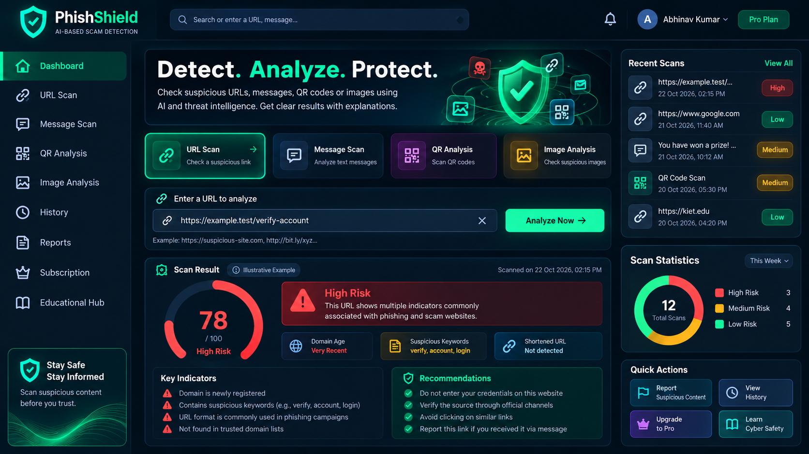

# 🛡️ PhishShield — AI-Assisted Scam Detection Platform

### Detect suspicious links. Analyze scam messages. Check QR and payment-related signals. Stay safer online.

PhishShield is an AI-assisted cybersecurity project designed to help students and everyday internet users identify potential phishing attempts, suspicious messages, risky QR codes, and payment-related warning signs before taking action.

The platform combines machine-learning predictions, rule-based indicators, supported image-analysis workflows, account-based scan history, and practical security recommendations in one web application.

<p align="center">
  <a href="https://phish-shield-six.vercel.app/"><strong>🚀 Live Demo</strong></a> •
  <a href="https://phishshield-api-z8oe.onrender.com/docs"><strong>📚 API Documentation</strong></a> •
  <a href="https://github.com/abhinav25005229-creator/PhishShield"><strong>💻 Source Code</strong></a>
</p>

<p align="center">
  
  
  
  
  
</p>

> **Disclaimer:** PhishShield provides automated risk estimates for educational and informational purposes. A low-risk result does not guarantee that content is safe, and a high-risk result does not independently prove fraud. Always verify important requests through trusted official channels.

---

## 📸 Dashboard Preview

<p align="center">
  
</p>

The dashboard brings scanning tools, recent activity, risk indicators, recommendations, and account navigation together in a single interface.

*To display this image on GitHub, save the dashboard screenshot at `docs/images/phishshield-dashboard.png` in the repository.*

---

## 🌐 Live Application

| Component | Link |
|---|---|
| 🌍 Frontend | [PhishShield Website](https://phish-shield-six.vercel.app/) |
| ⚙️ Backend API | [Render API](https://phishshield-api-z8oe.onrender.com/) |
| 📖 Interactive API Docs | [FastAPI Swagger UI](https://phishshield-api-z8oe.onrender.com/docs) |
| ❤️ Health Check | [Backend Health](https://phishshield-api-z8oe.onrender.com/health) |
| 💻 Source Code | [GitHub Repository](https://github.com/abhinav25005229-creator/PhishShield) |

**Deployment architecture:** The React frontend is deployed on Vercel, while the Python/FastAPI backend is deployed on Render.

The backend currently reports SQLite as its database. Render's free instance may spin down after inactivity, causing a delay on the first request.

---

## ✨ Features

### 🔗 URL and Phishing Detection
- Analyze submitted URLs for suspicious patterns.
- Identify relevant URL indicators and suspicious keywords.
- Estimate risk and present an explanatory result.
- Provide recommendations for safer browsing.

### 💬 Message Scam Detection
- Analyze suspicious text messages.
- Examine scam-related language, urgency, suspicious requests, and links.
- Present risk-related indicators and safety guidance.

### 📱 QR Code and UPI Analysis
- Analyze decoded QR content through the QR-analysis workflow.
- Inspect payment-related information for relevant warning signs.
- Help users recognize suspicious payment requests.

*QR or UPI analysis cannot independently verify a recipient's real-world identity, account ownership, or the legitimacy of a payment.*

### 🖼️ Image and Screenshot Analysis
- Submit supported images for analysis.
- Examine available image content for potential scam indicators.
- Use optional AI integrations when properly configured.

### 📄 Offer Letter Analysis
- Use the supported image-analysis workflow to examine offer letters for potential warning signs.
- Treat the result as an initial assessment, not proof that an offer or employer is genuine or fraudulent.

### 🔐 Authentication and Account Dashboard
- Register a new account and sign in.
- Use authenticated API endpoints.
- Access account-specific functionality.

### 📊 Personal Scan History
- Review saved scans and their estimated risk scores.
- Access scan history through the authenticated API.

### 🚨 Reporting Workflow
- Submit suspicious content for review.
- Provide a workflow for reviewing submitted reports through administrative endpoints.

### 📚 Scam Awareness Library
- Browse educational posts.
- Learn about phishing, suspicious requests, and safer digital habits.

### 🌐 English and Hindi Guidance
- Support English and Hindi explanations where implemented by the backend's rules and response logic.

### 💳 Subscription Interface
- Explore available subscription plans.
- Payment-related endpoints are available in the backend.
- End-to-end payment verification and premium-feature enforcement require separate testing before being considered production-ready.

---

## 🧰 Technology Stack

| Component | Technologies |
|---|---|
| Frontend | React, Vite, JavaScript, CSS |
| Backend | Python, FastAPI, Uvicorn |
| Machine Learning | scikit-learn, TF-IDF, Logistic Regression |
| Data Processing | NumPy and relevant Python data-processing tools |
| Database | SQLite by default; PostgreSQL connection configurable |
| ORM | SQLAlchemy |
| Authentication | Password hashing, signed bearer tokens |
| Model Persistence | Joblib |
| API Documentation | FastAPI and OpenAPI/Swagger UI |
| Rate Limiting | SlowAPI |
| Frontend Hosting | Vercel |
| Backend Hosting | Render |
| Version Control | Git and GitHub |

*Optional AI and payment integrations require their respective configuration and credentials. Listing an integration does not imply that its external service is enabled in the live deployment.*

---

## 🏗️ System Architecture

```text
                    ┌─────────────────────────┐
                    │      User / Browser     │
                    └────────────┬────────────┘
                                 │
                                 ▼
                    ┌─────────────────────────┐
                    │   React + Vite Frontend │
                    │      Deployed on Vercel │
                    └────────────┬────────────┘
                                 │ HTTPS / JSON
                                 ▼
                    ┌─────────────────────────┐
                    │     FastAPI Backend     │
                    │      Deployed on Render │
                    └────────────┬────────────┘
                                 │
              ┌──────────────────┼──────────────────┐
              │                  │                  │
              ▼                  ▼                  ▼
    ┌─────────────────┐ ┌─────────────────┐ ┌─────────────────┐
    │ URL and Message │ │ Rule-Based Risk │ │ QR and Image    │
    │ Classification  │ │ Indicators      │ │ Analysis        │
    └─────────────────┘ └─────────────────┘ └─────────────────┘
                                 │
                                 ▼
                    ┌─────────────────────────┐
                    │ Authentication, History │
                    │ Reports and Other APIs  │
                    └────────────┬────────────┘
                                 │
                                 ▼
                    ┌─────────────────────────┐
                    │ SQLite / Configurable   │
                    │ PostgreSQL Database     │
                    └─────────────────────────┘
```

### Request Flow

1. The user submits a URL, message, QR-related input, or supported image.
2. The frontend sends a request to the configured backend API.
3. The backend processes the input using the relevant analysis workflow.
4. The application returns the available risk assessment and explanatory indicators.
5. Authenticated workflows can associate saved activity with a user account.

---

## 📂 Project Structure

The repository contains separate frontend and backend applications. The main structure is:

```text
PhishShield/
├── backend/
│   ├── app/
│   │   ├── main.py
│   │   ├── ai.py
│   │   └── features.py
│   ├── data/
│   ├── models/
│   ├── .env.example
│   ├── requirements.txt
│   ├── train.py
│   └── prepare_data.py
├── frontend/
│   ├── public/
│   ├── src/
│   ├── package.json
│   └── vite.config.js
├── docs/
│   └── images/
│       └── phishshield-dashboard.png
├── .gitignore
└── README.md
```

*This is a high-level overview, not an exhaustive listing of every file. Refer to the repository for the current structure. Model and data filenames can vary with the committed version.*

---

## 🚀 Getting Started

Follow these instructions to run PhishShield locally.

### Prerequisites

Install the following:

- Python 3.10 or later, compatible with the project's dependencies
- Node.js and npm
- Git

### 1. Clone the repository

```bash
git clone https://github.com/abhinav25005229-creator/PhishShield.git
cd PhishShield
```

### 2. Configure the backend

Enter the backend directory and create a virtual environment:

```powershell
cd backend
python -m venv .venv
```

Activate it on Windows PowerShell:

```powershell
.\.venv\Scripts\Activate.ps1
```

Install backend dependencies:

```powershell
python -m pip install -r requirements.txt
```

Create a local environment file from the example:

```powershell
Copy-Item .env.example .env
```

Open `backend/.env` and configure the variables required by your application. Generate a strong, unique authentication secret and a separate administrative token.

Do not commit `.env` or copy real secrets into the README.

Start the backend from the `backend` directory:

```powershell
python -m uvicorn app.main:app --reload --host 127.0.0.1 --port 8010
```

Backend endpoints:

- API: `http://127.0.0.1:8010`
- Swagger UI: `http://127.0.0.1:8010/docs`
- Health check: `http://127.0.0.1:8010/health`

### 3. Configure the frontend

Open a second terminal at the repository root:

```powershell
cd frontend
npm install
```

Create `frontend/.env` with the following configuration:

```dotenv
VITE_API=http://localhost:8010
```

Start the frontend:

```powershell
npm run dev
```

Open the local URL printed by Vite, usually:

`http://localhost:5173`

Restart the Vite development server after changing environment variables.

### 4. Configure CORS for local development

Make sure the backend's allowed origins include the exact local frontend origin. For example:

```dotenv
ALLOWED_ORIGINS=http://localhost:5173,http://localhost:5174
```

Only include origins that you actually use. Configure the deployed frontend origin separately in the production environment.

---

## ⚙️ Environment Variables

Use `backend/.env.example` as the source of truth for backend configuration. The variables below describe the documented configuration options.

| Variable | Purpose |
|---|---|
| `AUTH_SECRET` | Secret used for authentication token signing |
| `ADMIN_TOKEN` | Token used to protect administrative functionality |
| `ALLOWED_ORIGINS` | Comma-separated allowed frontend origins, as supported by the backend |
| `DATABASE_URL` | Optional database connection string; PostgreSQL can be configured |
| `ANTHROPIC_API_KEY` | Optional API key for supported image-analysis integration |
| `AI_MODEL` | Configured AI model name |
| `RAZORPAY_KEY_ID` | Payment integration key ID |
| `RAZORPAY_KEY_SECRET` | Payment integration secret |

### Security Best Practices

- Keep `.env` files out of version control.
- Never commit passwords, API keys, authentication tokens, or database files containing private user data.
- Generate unique, strong secrets for each environment.
- Store production secrets in the hosting provider's environment-variable settings.
- Restrict administrative access and rotate exposed credentials.
- Avoid collecting real OTPs, UPI PINs, card credentials, or other payment secrets.

---

## 🧠 Machine Learning and Risk Assessment

PhishShield's intended URL and message analysis workflows combine trained classification models with rule-based indicators.

The project uses scikit-learn-related tooling, including TF-IDF and Logistic Regression, for supported classification workflows. Saved model artifacts may be loaded from the backend's models directory.

### Model Training

Review the dataset format, preprocessing steps, and configuration in `backend/train.py` before retraining.

From the `backend` directory, where the script and its dependencies are available:

```bash
python train.py
```

Check the script's input requirements before running it. Training may require the expected datasets to be present in the project's data directory.

### Evaluating Model Performance

Model quality should be assessed on an appropriate held-out dataset using measures such as:

- Precision
- Recall
- F1-score
- Confusion matrix
- False-positive and false-negative rates

No accuracy, precision, recall, or F1-score is claimed in this README without verified evaluation results. Performance depends on training data quality, class balance, preprocessing, and real-world input distribution.

**Important:** A model prediction or risk score is an estimate, not a guarantee of safety or fraud.

---

## 🔌 API Reference

The deployed FastAPI backend exposes the following documented endpoints.

| Method | Endpoint | Purpose |
|---|---|---|
| `GET` | `/health` | Check API and database connectivity |
| `POST` | `/auth/register` | Register a user |
| `POST` | `/auth/login` | Authenticate a user |
| `GET` | `/auth/me` | Retrieve the authenticated user's account |
| `GET` | `/history` | Retrieve scan history |
| `POST` | `/analyze/url` | Analyze a URL |
| `POST` | `/analyze/message` | Analyze a text message |
| `POST` | `/analyze/qr` | Analyze QR-related input |
| `POST` | `/analyze/image` | Analyze a supported image |
| `POST` | `/report` | Submit a suspicious-content report |
| `GET` | `/admin/reports` | Retrieve reports for administrative review |
| `PATCH` | `/admin/reports/{rid}` | Review or update a report |
| `GET` | `/metrics` | Retrieve available model metrics |
| `GET` | `/stats` | Retrieve aggregate statistics |
| `GET` | `/posts` | Retrieve educational posts |
| `GET` | `/posts/{slug}` | Retrieve an educational post |
| `POST` | `/admin/posts` | Create an educational post |
| `POST` | `/api/create-order` | Create a payment order |
| `POST` | `/api/verify-payment` | Verify a payment |

Administrative endpoints require the appropriate authorization. Authentication-protected endpoints require the expected bearer token.

Explore the request schemas, required fields, and response formats in the live Swagger documentation:

**[Open PhishShield Swagger UI](https://phishshield-api-z8oe.onrender.com/docs)**

---

## 🧪 Testing and Verification

The deployed application has been manually tested for:

- User registration
- User login
- URL scanning
- Message scanning
- Basic frontend-to-backend API communication

The following areas should be tested further before relying on the platform for real users:

- QR decoding and UPI-related analysis across diverse inputs
- Image and offer-letter analysis with and without optional integrations
- User-specific scan-history isolation
- Administrative authorization and report moderation
- Payment creation, signature verification, and subscription activation
- Database persistence across restarts and redeployments
- API input validation, error handling, and rate limiting

These are testing priorities, not claims that every scenario has already passed.

---

## 🗄️ Database and Persistence

The current deployed health endpoint reports SQLite as the configured database.

SQLite is useful for local development and prototypes. However, a local database file on an ephemeral hosting filesystem may not persist across restarts, redeployments, or instance replacement.

Before using PhishShield for production data:

1. Configure PostgreSQL or another suitable persistent database.
2. Verify database initialization and schema migrations.
3. Test account isolation and transaction handling.
4. Configure backups and recovery procedures.
5. Verify persistence after redeployment.

Although PostgreSQL configuration is supported as an option in the project, a complete production migration should not be assumed until it has been configured and tested.

---

## 🔒 Security, Privacy and Responsible Use

PhishShield is designed to support safer decision-making, not replace independent verification.

- Passwords should be stored as hashes, never as plaintext.
- Authentication tokens and administrative secrets must remain private.
- Scan history should be accessible only to the appropriate account.
- External AI and threat-intelligence services may process submitted content according to their own terms and privacy practices.
- QR and UPI indicators cannot prove the identity of a recipient or confirm that a payment request is genuine.
- A safe-looking URL or low-risk score must not be treated as proof of legitimacy.

Do not submit sensitive personal information, payment credentials, OTPs, or UPI PINs to the application.

### Reporting Suspected Financial Cyber Fraud in India

If you suspect financial cyber fraud, contact India's cybercrime helpline at **1930** and use the official reporting portal:

[https://cybercrime.gov.in/](https://cybercrime.gov.in/)

---

## 🛣️ Future Improvements

Potential improvements include:

- Migrating the deployed database to persistent PostgreSQL storage
- Adding reproducible ML evaluation and documented datasets
- Improving QR decoding reliability and UPI risk-indicator quality
- Expanding and validating threat-intelligence integrations
- Improving user-isolation, authentication, and authorization tests
- Completing end-to-end payment and subscription testing
- Adding automated API tests and continuous integration
- Improving monitoring, error reporting, and production observability
- Enhancing mobile responsiveness and accessibility
- Expanding English and Hindi educational guidance

---

## 🤝 Contributing

Contributions, issue reports, and suggestions are welcome.

1. Fork the repository.
2. Create a feature branch.
3. Make focused changes.
4. Test your changes locally.
5. Open a pull request describing the changes and relevant test results.

Please do not include secrets, private user data, or sensitive database files in commits or issue reports.

---

## 📄 License

A license has not been specified in this README. Add a suitable license file before explicitly granting others permission to reuse, modify, or distribute the project.

---

<p align="center">
  <strong>PhishShield — Promoting safer digital habits through cybersecurity and machine-learning tools.</strong>
</p>
